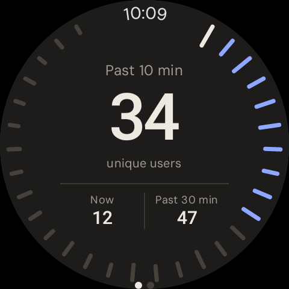
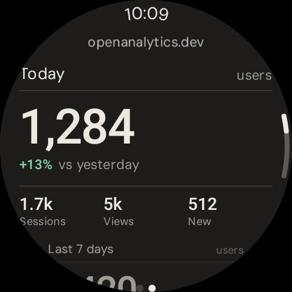
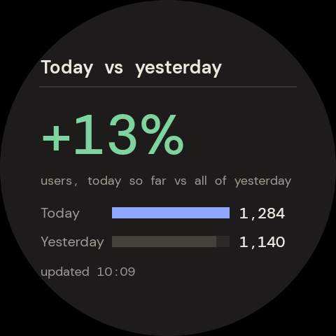
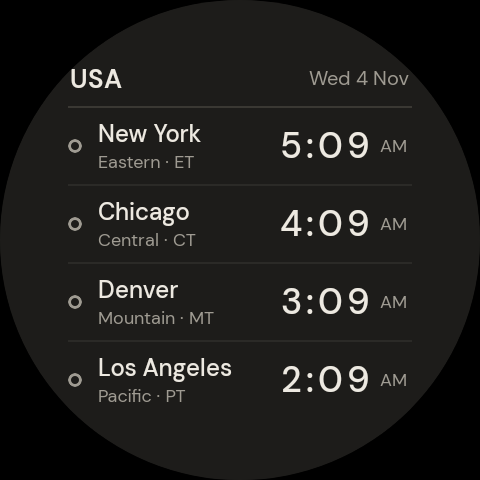

# openAnalytics

A standalone **Wear OS** app and set of tiles that show your **Google Analytics 4** stats on your wrist. You build and sideload it yourself. It signs in with the Google account that's already on your watch.

**The app** has two pages; swipe between them:

1. **Minute ring:** 30 ticks around the edge, one per minute, sized by traffic. **Turn the bezel** (swipe around the edge on a Galaxy Watch 7) or **tap a tick** to choose how far back to count. The centre shows unique users in that window, plus **Now** and **Past 30 min**.
2. **Dashboard:** Today (vs yesterday), Last 7 days (vs the prior week, with daily bars), pages people are on now, top pages and countries this week, then Refresh / Change property / Sign out.

**Tiles.** Add any of these from the tile picker:

| Tile | Shows |
| --- | --- |
| **Active users** | Minute ring, unique users in the past 30 min, users right now |
| **Today vs yesterday** | % change, with bars for today so far and all of yesterday |
| **Today's users** | Today's total, an hourly bar chart, sessions and views |
| **US clock** | New York, Chicago, Denver and Los Angeles, with a day/night marker |

<p align="center">
  
  
  
  
</p>

These are rendered with sample data at Galaxy Watch 7 44 mm size (480 px). CI re-renders them on every push. The full set, including 40 mm, is in [`docs/screenshots/`](docs/screenshots/).

## How sign-in works

The app uses the Google account on the watch, through Google Play services, and asks for read-only Analytics access (`analytics.readonly`). After you sign in, it lists every GA4 property your account can see, and you pick one on the watch. There are no keys or files to copy.

Google only issues tokens to apps it knows about, so you need to register the app in Google Cloud once. It takes about 5 minutes and you only do it once.

### Google Cloud setup (one-off)

1. Open [Google Cloud Console](https://console.cloud.google.com/) and create a project, or pick an existing one.
2. **APIs & Services → Library**: enable **Google Analytics Data API** and **Google Analytics Admin API**.
3. **Google Auth Platform → Branding / Audience** (the OAuth consent screen):
   - User type **External**, any app name, your email as support contact.
   - Under **Data access**, add the scope `https://www.googleapis.com/auth/analytics.readonly`.
   - Under **Audience**, either:
     - add yourself as a **test user**. In *Testing* mode, Google expires the access after 7 days and you'll have to sign in again; or
     - click **Publish app**. Personal use doesn't need verification. You'll see a "Google hasn't verified this app" warning once; choose *Advanced → Go to openAnalytics*. Access then doesn't expire.
4. **Clients → Create client → Android**:
   - Package name: `dev.openanalytics.wear`
   - SHA-1: `20:67:F3:20:7C:FB:70:08:C7:D9:E5:95:38:02:5B:9D:5E:C4:03:2F`

The app doesn't need a client ID or any secret. Google matches it by package name and SHA-1.

> **About the SHA-1:** every build, local or CI, is signed with `app/openanalytics-debug.keystore`, which is committed to this repo, so the fingerprint above always matches. Because the key is public, anyone could build an APK that installs as an update over yours. That's acceptable for a personal sideloaded app. If you want your own key, replace the keystore, update `signingConfigs` in `app/build.gradle.kts`, and register the new SHA-1. Get it with `keytool -list -v -keystore <file>`.

## Build

- **GitHub Actions:** every push builds `openAnalytics-debug-apk` and the `screenshots` artifact.
- **Locally:** run `./gradlew assembleDebug`. You need JDK 17+ and the Android SDK.

## Install on the watch (Galaxy Watch 7 or any Wear OS 3+ watch)

1. On the watch: go to **Settings → About watch → Software → Software version** and tap it 5 times. Then go to **Settings → Developer options** and turn on **ADB debugging** and **Wireless debugging**.
2. From your computer:
   ```sh
   adb pair <ip>:<pairing-port>     # "Pair new device" under Wireless debugging
   adb connect <ip>:<port>
   adb install -r app-debug.apk
   ```
3. Open **openAnalytics** on the watch, tap **Sign in with Google**, allow access, and pick your property.
4. To add tiles, swipe left from the watch face, tap **+**, and pick **Active users**, **Today vs yesterday**, **Today's users** or **US clock**.

Use **Change property** or **Sign out** at the bottom of the app to switch.

## Tiles and refreshing

The three analytics tiles share one fetch. The system refreshes them about every 15 min, and while the app is open it pushes fresh numbers to them. If a tile can't connect, it shows its last numbers with a red "offline · time" line. Tapping any tile opens the app. The US clock tile needs no data; it updates every minute by itself.

In the app, realtime numbers refresh every 60 s and the rest every 10 min. Nothing polls in the background.

## Troubleshooting

| Message | Fix |
| --- | --- |
| Sign-in rejected (DEVELOPER_ERROR) | The Android OAuth client is missing, or its package name or SHA-1 doesn't match. See step 4. |
| HTTP 403 | Your account lacks Viewer access to the property, or the Data/Admin APIs aren't enabled in the project from step 2. |
| Signed out after a week | The consent screen is still in *Testing*. Publish it (step 3). |
| Network error | The watch has no connection. On Bluetooth-only watches, check that the phone is online. |

## Project layout

```
app/src/main/java/dev/openanalytics/wear/
  data/      GA4 Data/Admin API client (plain JVM code, unit tested)
  auth/      Google account sign-in and tokens (Play services)
  config/    selected property, cached snapshot for the tiles
  ui/        Compose for Wear OS screens, minute ring, charts, ViewModel
  tile/      the four tiles (ProtoLayout)
app/src/test/  unit tests, plus Robolectric/Roborazzi screenshot tests
```

The app uses [DM Sans](https://github.com/googlefonts/dm-fonts) under the SIL Open Font License ([`licenses/DM-Sans-OFL.txt`](licenses/DM-Sans-OFL.txt)).

- Unit tests: `./gradlew testDebugUnitTest`
- Screenshots: `./gradlew recordRoborazziDebug` writes them to `app/screenshots/`
